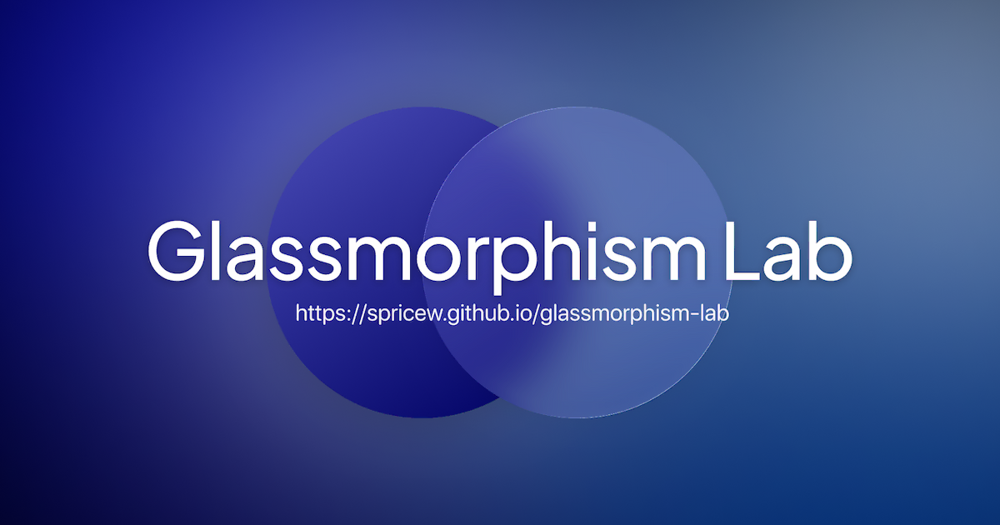

# Glassmorphism Lab

**El vidrio esmerilado de iOS no es un blur: es una pila de capas.**

Laboratorio interactivo que descompone el _frosted glass_ de Apple (`backdrop-filter`, saturación, tinte, hairline, brillo, sombra, esquinas continuas y vibrancy) capa por capa, en CSS puro y en vivo. Arrastra el panel sobre el fondo, apaga las capas una por una y mira exactamente qué se pierde.


   

## Qué puedes hacer

- **Jugar con el panel.** Arrástralo (o muévelo con las flechas) sobre tres fondos distintos: `Mosaico`, `Paisaje` y `App`.
- **Encender y apagar capas.** Inspector con relleno (desenfoque, saturación, tinte, grano), acabado (hairline de 0,5 px, brillo interior, sombra en dos capas), forma (esquinas continuas + radio) y texto (vibrancy).
- **Cambiar el grosor.** Cinco materiales calibrados: `XS`, `S`, `M`, `L`, `XL` (`ultraThin` → `ultraThick`).
- **Comparar vistas.** `Receta completa` contra `Solo blur`, más un botón _mantén pulsado_ para ver el efecto sin ninguna capa.
- **Ver la construcción paso a paso.** Ocho miniaturas que suman una capa por celda, con la apariencia y el fondo que hayas elegido.
- **Copiar el CSS resultante.** Se genera la receta de verdad (no la vista naive) con un botón de copiado.
- **Cambiar de tema.** Apariencia clara u oscura, con `prefers-color-scheme` y `prefers-reduced-motion` respetados.
- **Cambiar de idioma.** El botón del navbar alterna entre español (por defecto, en `/`) e inglés (`/en/`); todo el contenido, incluidos los textos generados en runtime, se traduce.

## Detalles que no se ven

- **Vibrancy real** con `mix-blend-mode: multiply` en claro y `plus-lighter` en oscuro, aplicado fuera del elemento con `backdrop-filter`.
- **Grano generado en canvas** (ruido neutro con alfa aleatorio) para romper el _banding_ de los degradados difuminados.
- `corner-shape: squircle` con detección de soporte y degradado limpio a arco circular cuando el navegador no lo entiende.
- **Fondos como SVG en data URI** construidos en runtime, con bordes nítidos para que el blur se note.
- **Accesibilidad**: skip link, segmentados con `role="radio"` y navegación por teclado, anuncios `aria-live` y safe areas de iOS.
- **SEO**: JSON-LD (`WebSite`, `Person`, `SoftwareApplication`, `HowTo`, `FAQPage`), Open Graph, Twitter Cards, sitemap, robots y web manifest.
- **Bilingüe (es/en)** con el i18n de Astro (`prefixDefaultLocale: false`): un diccionario tipado en `lib/i18n.ts`, `hreflang` cruzado y un único botón que alterna de idioma.

## Stack

| Pieza | Uso |
| --- | --- |
| [Astro 7](https://astro.build) | Sitio estático, marcado generado en servidor |
| TypeScript 6 | Tipado estricto, sin `any` |
| CSS nativo | Sin frameworks de UI; variables y `color-mix()` |
| [Vitest](https://vitest.dev) + jsdom | Tests unitarios del material |
| Geist / Geist Mono | Tipografías self-hosted (`.woff2`) |

## Estructura

```
src/
├─ components/     Nav, Switch, Seg, StepCard, FaqItem, BuildSection, SiteFooter
├─ fonts/          Geist y Geist Mono (self-hosted)
├─ lab/            motor de cliente: init, render, events, inspector, panels
├─ layouts/        Base (head, SEO, a11y), HomePage y NotFound (por idioma)
├─ lib/
│  ├─ frosted/     definición del material: estado, capas, pasos, CSS
│  ├─ material.ts  contratos (Material, Effect, AppState…)
│  ├─ backgrounds  fondos SVG generados en runtime
│  ├─ hilite.ts    resaltado del CSS resultante
│  ├─ i18n.ts      diccionario es/en tipado y helpers de idioma
│  ├─ site.ts      contenido y datos estructurados
│  └─ utils.ts     helpers y capacidades del navegador
├─ pages/          index y 404 (es), en/ (en), robots, sitemap, web manifest
└─ styles/         global.css, frosted.css, fonts.css
```

## Empezar

Requisitos: **Node ≥ 22.12** y **pnpm 12.10.1**.

```bash
pnpm install
pnpm dev        # servidor de desarrollo
pnpm build      # build a dist/
pnpm preview    # sirve el build
pnpm check      # Astro + TypeScript
pnpm test       # Vitest
```

El sitio se publica en GitHub Pages desde `main` con el workflow de `.github/workflows/deploy.yml`.

## Sobre la precisión

Los grosores son **aproximaciones calibradas a ojo**, no valores internos de iOS. La referencia pública más cercana es el sample code [UIImageEffects](https://developer.apple.com/library/archive/samplecode/UIImageEffects/Introduction/Intro.html), que usa saturación `1.8` y un tinte de alfa `0.3–0.82` según el estilo. Además, el `blur()` de CSS es una desviación estándar, así que no equivale 1 a 1 al radio de esas funciones.

---

Hecho por [spricew](https://github.com/spricew) · [glassmorphism-lab](https://github.com/spricew/glassmorphism-lab)
